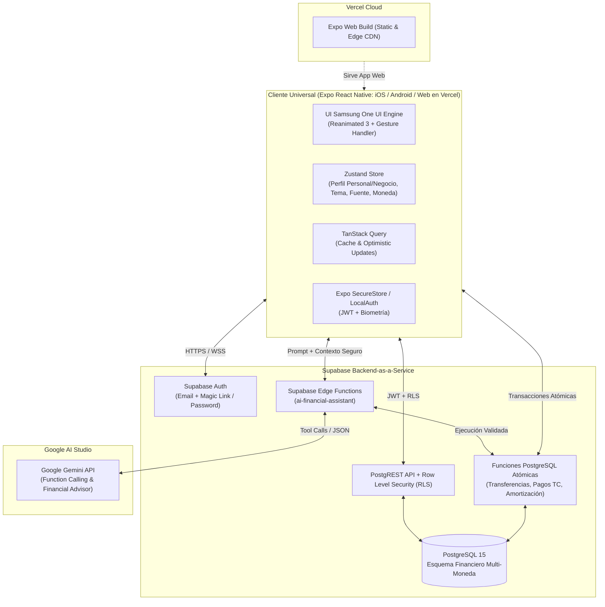

# 04. Arquitectura Técnica, Esquema de Base de Datos y Despliegue — MisAhorros

---

## 1. Stack Tecnológico Oficial

| Capa | Tecnología | Propósito |
| :--- | :--- | :--- |
| **Framework Móvil & Web** | **React Native + Expo SDK 52+** (Expo Router v4) | Código único universal para Android, iOS y Web PWA. |
| **Motor de Animaciones** | **React Native Reanimated v3 + Gesture Handler + Skia** | Animaciones 60/120 FPS estilo Samsung One UI y gráficas financieras fluidas. |
| **Estado y Caché Reactivo** | **Zustand + TanStack Query v5** | Gestión de estado global (tema, perfil activo, divisa) y sincronización optimista con Supabase. |
| **Backend & Base de Datos** | **Supabase (PostgreSQL 15+)** | Autenticación por Email/OTP, Base de datos relacional, RLS y funciones RPC atómicas. |
| **Inteligencia Artificial** | **Google Gemini API (`gemini-2.5-flash`) vía Supabase Edge Functions** | Chatbot financiero con Function Calling para consultas, asesoría y registro por lenguaje natural. |
| **Alojamiento Web & CI/CD** | **Vercel** | Despliegue continuo de la versión Web (`expo export -p web`) con CDN global. |

---

## 2. Diagrama de Arquitectura del Sistema

---

## 3. Diagrama Entidad-Relación (ERD) Completo en PostgreSQL

```mermaid
erDiagram
    USERS_PROFILES ||--o{ FINANCIAL_PROFILES : "posee (Personal / Negocio)"
    FINANCIAL_PROFILES ||--o{ ACCOUNTS : "contiene (Efectivo, Bancos)"
    FINANCIAL_PROFILES ||--o{ CATEGORIES : "clasifica"
    FINANCIAL_PROFILES ||--o{ TRANSACTIONS : "registra (Ingresos/Gastos/Transferencias)"
    FINANCIAL_PROFILES ||--o{ CREDIT_CARDS : "administra"
    FINANCIAL_PROFILES ||--o{ PAYABLES_SUBSCRIPTIONS : "programa (Cuentas por pagar/Fijos)"
    FINANCIAL_PROFILES ||--o{ LOANS : "gestiona (Recibidos y Otorgados)"
    FINANCIAL_PROFILES ||--o{ BUDGETS : "controla (Diario/Semanal/Quincenal/Mensual)"
    FINANCIAL_PROFILES ||--o{ SAVINGS_GOALS : "ahorra en"
    FINANCIAL_PROFILES ||--o{ FINANCIAL_INSTRUMENTS : "invierte en (CDP, Pensión, Bolsa)"
    FINANCIAL_PROFILES ||--o{ AGENDA_REMINDERS : "agenda"
    FINANCIAL_PROFILES ||--o{ AI_CHAT_MESSAGES : "conversa con Gemini"

    USERS_PROFILES {
        uuid id PK "auth.users.id"
        text email
        text full_name
        text theme_mode "dark | light | amoled"
        text accent_color "emerald | ocean | gold | amethyst | coral"
        text font_family "jakarta | inter | space_grotesk"
        text default_currency "HNL | USD | EUR | MXN"
        boolean is_salaried
        boolean has_business
        boolean hide_balances_default
        timestamptz created_at
    }

    FINANCIAL_PROFILES {
        uuid id PK
        uuid user_id FK
        text profile_type "personal | business"
        text display_name "Finanzas Personales | Nombre del Negocio"
        text base_currency "HNL | USD"
        text tax_id "RTN / NIT opcional para negocio"
        boolean is_active
    }

    ACCOUNTS {
        uuid id PK
        uuid user_id FK
        uuid profile_id FK
        text name "Efectivo, BAC Planilla, Ficohsa USD"
        text account_type "cash | checking | savings | payroll | digital_wallet"
        text currency "HNL | USD"
        numeric current_balance "NUMERIC(15,2)"
        text bank_name
        text color_hex
        text icon_name
        boolean include_in_total
    }

    TRANSACTIONS {
        uuid id PK
        uuid user_id FK
        uuid profile_id FK
        uuid account_id FK "Nullable si fue con Tarjeta de Crédito"
        uuid credit_card_id FK "Nullable si fue con Cuenta de Activo"
        uuid target_account_id FK "Para transferencias"
        uuid category_id FK
        text transaction_type "income | expense | transfer | card_payment | loan_payment"
        text income_subtype "payroll | regular | irregular | null"
        numeric amount "NUMERIC(15,2)"
        text currency "HNL | USD"
        numeric exchange_rate "NUMERIC(12,6) default 1"
        text description "Motivo del movimiento"
        timestamptz transaction_date
        uuid linked_payable_id FK
        uuid linked_loan_id FK
        boolean created_by_ai
    }

    CREDIT_CARDS {
        uuid id PK
        uuid user_id FK
        uuid profile_id FK
        text card_name "Visa Infinite BAC"
        text bank_name
        text network "visa | mastercard | amex"
        text currency "HNL | USD"
        numeric credit_limit "NUMERIC(15,2)"
        numeric statement_balance "Saldo al último corte"
        numeric unbilled_balance "Compras después del corte"
        int closing_day "1-31"
        int due_day "1-31"
        numeric interest_rate_annual "TAN %"
        numeric default_interest_rate "Tasa moratoria %"
        text color_theme
    }

    PAYABLES_SUBSCRIPTIONS {
        uuid id PK
        uuid user_id FK
        uuid profile_id FK
        uuid category_id FK
        text title "Netflix, Alquiler Local, Proveedor X"
        text payable_type "subscription | fixed_expense | payable_debt"
        numeric amount "NUMERIC(15,2)"
        text currency "HNL | USD"
        text frequency "once | weekly | biweekly | monthly | yearly"
        date next_due_date
        int current_installment "Ej. Cuota 4"
        int total_installments "Ej. de 12 (Null si es indefinido)"
        numeric late_interest_rate "Tasa en caso de atraso"
        numeric late_fixed_fee "Recargo fijo por atraso"
        int remind_days_before "Ej. 3 días antes"
        text status "pending | paid | overdue"
        timestamptz last_paid_at
    }

    LOANS {
        uuid id PK
        uuid user_id FK
        uuid profile_id FK
        text loan_direction "received (Pasivo) | granted (Activo por cobrar)"
        text counterparty_name "Banco Atlántida | Cliente Juan Pérez"
        numeric principal_amount "Monto original"
        numeric remaining_balance "Capital pendiente"
        text currency "HNL | USD"
        numeric annual_interest_rate "Tasa anual %"
        numeric late_interest_rate "Tasa mora %"
        int term_months "Plazo en meses"
        numeric installment_amount "Cuota nivelada o pactada"
        text frequency "weekly | biweekly | monthly"
        date start_date
        date next_payment_date
        uuid disbursed_account_id FK
        text status "active | paid_off | defaulted"
    }

    FINANCIAL_INSTRUMENTS {
        uuid id PK
        uuid user_id FK
        uuid profile_id FK
        text instrument_type "term_deposit (CDP) | pension_fund | stock_etf | crypto | real_estate"
        text institution_name "Banco / AFP / Broker"
        text name "Certificado a Plazo 12M / AFP"
        text currency "HNL | USD"
        numeric invested_capital "Capital aportado"
        numeric current_value "Valor actual o acumulado"
        numeric annual_yield_rate "Rendimiento anual %"
        numeric tax_withholding_rate "Retención ISR %"
        date start_date
        date maturity_date "Fecha de vencimiento (CDP)"
        boolean auto_renew
    }

    SAVINGS_GOALS {
        uuid id PK
        uuid user_id FK
        uuid profile_id FK
        uuid linked_account_id FK "Opcional cuenta vinculada"
        text name "Fondo de Emergencia, Viaje, Maquinaria"
        numeric target_amount "NUMERIC(15,2)"
        numeric current_amount "NUMERIC(15,2)"
        text currency "HNL | USD"
        date target_date
        text color_hex
        text icon_name
    }

    BUDGETS {
        uuid id PK
        uuid user_id FK
        uuid profile_id FK
        uuid category_id FK "Null = Presupuesto Global del Perfil"
        text name "Presupuesto Quincenal Supermercado"
        text period_type "daily | weekly | biweekly | monthly"
        numeric limit_amount "NUMERIC(15,2)"
        text currency "HNL | USD"
        numeric alert_threshold_percent "Default 80%"
        boolean is_active
    }
```

