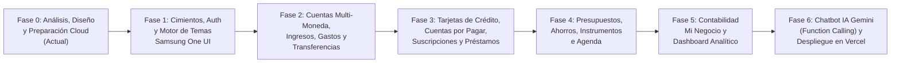

# 06. Plan de Fases de Desarrollo y Hoja de Ruta (Todo List Maestro) — MisAhorros

> [!IMPORTANT]
> **Control de Avance**: Ninguna fase posterior debe iniciarse sin haber validado que la fase anterior compila sin errores en Expo (Móvil y Web) y cumple con los estándares de seguridad RLS y animaciones Samsung One UI.

---

## Diagrama de Fases de Desarrollo

---

## Checklist Detallado por Fases (To-Do List)

### Fase 0: Arquitectura, Contexto y Preparación de Entornos (Fase Actual)
- [x] Definir reglas matemáticas y financieras de dominio (`01_CONTEXTO_Y_REGLAS_FINANCIERAS.md`).
- [x] Definir estándares de seguridad RLS y almacenamiento cifrado (`02_ESTANDARES_DE_SEGURIDAD.md`).
- [x] Definir sistema de diseño y físicas de animación Samsung One UI (`03_ESTANDARES_UI_UX_SAMSUNG_ANIMATIONS.md`).
- [x] Diseñar arquitectura cloud y diagrama Entidad-Relación (`04_ARQUITECTURA_Y_BASE_DE_DATOS.md`).
- [x] Elaborar presentación ejecutiva para inversionistas con costos y unit economics (`05_PRESENTACION_INVERSIONISTAS.md`).
- [x] Generar mockups de alta fidelidad de las pantallas clave de la aplicación.
- [ ] **Validación del Usuario** sobre la documentación y mockups.
- [ ] **Preparación y Vinculación de Proyectos**: Inicialización de Expo, proyecto en Supabase y vinculación con Vercel.

---

### Fase 1: Inicialización del Proyecto, Autenticación y Personalización Visual
- [ ] Inicializar proyecto Expo con TypeScript (`expo-router`, `react-native-reanimated`, `react-native-gesture-handler`, `lucide-react-native`).
- [ ] Ejecutar script SQL maestro en Supabase para crear tablas, índices, funciones RPC y políticas RLS.
- [ ] Configurar cliente Supabase con almacenamiento seguro (`expo-secure-store` en móvil / `localStorage` PKCE en Web).
- [ ] Implementar flujo de Autenticación por Email (Registro, Inicio de Sesión, Recuperación de contraseña).
- [ ] Construir el **Onboarding Inteligente**:
  - Selección de Moneda Base (`HNL`, `USD`, etc.).
  - Configuración laboral: ¿Es asalariado? (Configuración rápida de nómina) / ¿Tiene un negocio? (Activación del perfil `Mi Negocio`).
  - Personalización estética en vivo: Dark/AMOLED/Light Mode, paleta de colores base y tipografía (`Plus Jakarta Sans`, `Inter`, `Space Grotesk`).
- [ ] Implementar barra de navegación flotante estilo Samsung One UI con botón central `+` animado y selector superior `Personal` ↔ `Mi Negocio`.

---

### Fase 2: Motor de Cuentas, Ingresos, Gastos y Transferencias Atómicas
- [ ] CRUD de Cuentas (`Efectivo`, `Banco X`, `Banco Y`, `Billetera Digital`) con soporte multi-moneda e íconos/colores personalizados.
- [ ] Vista detallada de cada cuenta con su saldo actual, historial de movimientos filtrable y gráfico de evolución.
- [ ] Registro de **Ingresos**: Por nómina (con desglose opcional de deducciones), regulares e irregulares.
- [ ] CRUD de **Categorías de Gastos e Ingresos** personalizadas por perfil.
- [ ] Registro de **Gastos** seleccionando cuenta de origen (o tarjeta de crédito), categoría, monto, fecha y motivo.
- [ ] Motor de **Transferencias entre Cuentas** (incluyendo conversión multi-moneda y transferencias entre perfil `Personal` y `Mi Negocio`) mediante RPC transaccional en Supabase.

---

### Fase 3: Tarjetas de Crédito, Cuentas por Pagar, Suscripciones y Préstamos 360°
- [ ] Módulo de **Tarjetas de Crédito Multi-Tarjeta**:
  - Carrusel 3D animado con indicador de Límite Disponible, Saldo al Corte (Pago de Contado), Saldo Flotante, Fecha de Corte y Fecha Máxima de Pago.
  - Registro de compras con tarjeta (al contado o en cuotas de extrafinanciamiento) y pago de tarjeta desde cuentas bancarias.
- [ ] Módulo de **Cuentas por Pagar, Suscripciones y Gastos Fijos**:
  - Configuración de periodicidad (`semanal`, `quincenal`, `mensual`, `anual`), control de cuotas (`Cuota X de N`).
  - Cálculo automático de intereses moratorios y recargos en caso de atraso, y selección exacta del día en que se efectuó el pago.
- [ ] Módulo Dual de **Préstamos (`Loans`)**:
  - **Préstamos Recibidos (Pasivos)**: Tabla de amortización francesa, control de cuotas pagadas, intereses vs. capital y abonos extraordinarios.
  - **Préstamos Otorgados a Terceros (Cuentas por Cobrar)**: Desembolso desde cuenta, tasa de interés pactada, calendario de cobro y registro de abonos de clientes/deudores.

---

### Fase 4: Presupuestos Multitemporales, Ahorros, Instrumentos Financieros y Agenda
- [ ] Motor de **Presupuestos**: Creación y monitoreo en tiempo real de presupuestos `Diarios`, `Semanales`, `Quincenales` y `Mensuales` con barras de progreso animadas y alertas al 70%, 90% y 100%.
- [ ] Módulo de **Fondos de Ahorro y Metas**: Tarjetas visuales de metas (ej. Fondo de Emergencia, Vacaciones, Compra de Equipo) con aportes directos desde cuentas.
- [ ] Módulo de **Instrumentos Financieros e Inversiones**:
  - Configuración de **Depósitos a Plazo Fijo (CDP)** con cálculo de interés ganado, retención de impuestos y alerta de vencimiento.
  - Seguimiento de **Fondos de Pensión (AFP/RAP)** y portafolio de inversiones.
- [ ] **Agenda Financiera y Recordatorios**: Vista de calendario interactivo con todos los cortes de tarjeta, pagos de cuotas, cobros de préstamos, vencimientos de CDP y días de pago de nómina.

---

### Fase 5: Contabilidad Básica de Negocio y Dashboard Inteligente
- [ ] Vistas especializadas para el perfil **Mi Negocio**:
  - Estado de Flujo de Caja Operativo (Ingresos por Ventas vs. Costos Fijos y Variables = Utilidad Neta).
  - Control de cuentas por pagar a proveedores y cuentas por cobrar a clientes.
- [ ] **Dashboard Principal (Pantalla de Inicio)**:
  - Odómetro animado de Balance Total y Patrimonio Neto consolidado.
  - Widget de **Próximos Pagos** prioritarios (próximos 7 días).
  - Tarjeta dinámica de **Consejos Financieros Inteligentes** basados en las métricas reales del usuario (ej. ratio de endeudamiento, uso de crédito, velocidad de gasto del presupuesto).

---

### Fase 6: Chatbot IA con Google Gemini, Pulido Final y Despliegue en Vercel
- [ ] Desarrollar Supabase Edge Function `ai-financial-assistant` conectada a **Google Gemini (`gemini-2.5-flash`)** con declaraciones de funciones (`Function Calling`).
- [ ] Construir interfaz conversacional estilo Samsung One UI con:
  - Tarjetas interactivas de confirmación en el chat (`Gasto Registrado` con botones `Deshacer` / `Editar`).
  - Chips de acciones rápidas y soporte para resolver dudas financieras usando los datos reales del usuario.
- [ ] Compilación y despliegue de la versión Web PWA en **Vercel** conectada al repositorio/proyecto y verificación en **Expo Go** para dispositivos móviles.
