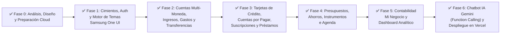

# 06. Plan de Fases de Desarrollo y Hoja de Ruta (Todo List Maestro) — MisAhorros

> [!IMPORTANT]
> **Estado Actual**: **¡TODAS LAS FASES (0 a 6) COMPLETADAS, VERIFICADAS Y DESPLEGADAS EN GITHUB / VERCEL!**

---

## Diagrama de Fases de Desarrollo

---

## Checklist Detallado por Fases (100% Completado)

### Fase 0: Arquitectura, Contexto y Preparación de Entornos
- [x] Definir reglas matemáticas y financieras de dominio (`01_CONTEXTO_Y_REGLAS_FINANCIERAS.md`).
- [x] Definir estándares de seguridad RLS y almacenamiento cifrado (`02_ESTANDARES_DE_SEGURIDAD.md`).
- [x] Definir sistema de diseño y físicas de animación Samsung One UI (`03_ESTANDARES_UI_UX_SAMSUNG_ANIMATIONS.md`).
- [x] Diseñar arquitectura cloud y diagrama Entidad-Relación (`04_ARQUITECTURA_Y_BASE_DE_DATOS.md`).
- [x] Elaborar presentación ejecutiva para inversionistas con costos y unit economics (`05_PRESENTACION_INVERSIONISTAS.md`).
- [x] Generar mockups de alta fidelidad de las pantallas clave de la aplicación.
- [x] **Validación del Usuario** sobre la documentación y mockups.
- [x] **Preparación y Vinculación de Proyectos**: Inicialización de Expo, proyecto en Supabase y vinculación con GitHub + Vercel.

---

### Fase 1: Inicialización del Proyecto, Autenticación y Personalización Visual
- [x] Inicializar proyecto Expo con TypeScript (`expo-router`, `react-native-reanimated`, `react-native-gesture-handler`, `lucide-react-native`).
- [x] Ejecutar script SQL maestro en Supabase para crear tablas, índices, funciones RPC y políticas RLS.
- [x] Configurar cliente Supabase con almacenamiento seguro (`expo-secure-store` en móvil / `AsyncStorage` en Web).
- [x] Implementar flujo de Autenticación por Email (Registro e Inicio de Sesión).
- [x] Construir el **Onboarding Inteligente**:
  - Selección de Moneda Base (`HNL`, `USD`, `EUR`, `MXN`).
  - Configuración laboral: ¿Es asalariado? / ¿Tiene un negocio?.
  - Personalización estética en vivo: Dark/AMOLED/Light Mode, 5 paletas de colores base y 3 tipografías (`Plus Jakarta Sans`, `Inter`, `Space Grotesk`).
- [x] Implementar barra de navegación Samsung One UI y selector superior `Personal` ↔ `Mi Negocio`.

---

### Fase 2: Motor de Cuentas, Ingresos, Gastos y Transferencias Atómicas
- [x] CRUD de Cuentas (`Efectivo`, `Banco X`, `Banco Y`, `Billetera Digital`) con soporte multi-moneda y colores personalizados.
- [x] Vista detallada filtrable por cada cuenta con su saldo actual e historial de movimientos.
- [x] Registro de **Ingresos**: Por nómina (`payroll`), regulares (`regular`) e irregulares (`irregular`).
- [x] Creación de **Categorías de Gastos e Ingresos** personalizadas por perfil.
- [x] Registro de **Gastos** seleccionando cuenta de origen (o tarjeta de crédito), categoría, monto y motivo.
- [x] Motor de **Transferencias entre Cuentas** (incluyendo conversión multi-moneda y transferencias entre perfil `Personal` y `Mi Negocio`) mediante RPC transaccional en Supabase.

---

### Fase 3: Tarjetas de Crédito, Cuentas por Pagar, Suscripciones y Préstamos 360°
- [x] Módulo de **Tarjetas de Crédito Multi-Tarjeta**:
  - Visualizador con Límite Disponible, Saldo al Corte (Pago de Contado), Saldo Flotante, Fecha de Corte y Fecha Máxima de Pago.
  - Pago de tarjeta desde cuentas bancarias con un toque.
- [x] Módulo de **Cuentas por Pagar, Suscripciones y Gastos Fijos**:
  - Configuración de periodicidad (`semanal`, `quincenal`, `mensual`, `único`), control de cuotas (`Cuota X de N`).
  - Cálculo automático de intereses moratorios y recargos en caso de atraso, y selección del día exacto en que se efectuó el pago.
- [x] Módulo Dual de **Préstamos (`Loans`)**:
  - **Préstamos Recibidos (Pasivos)**: Cálculo de cuota nivelada francesa, saldo pendiente y pago de cuotas.
  - **Préstamos Otorgados a Terceros (Cuentas por Cobrar)**: Desembolso desde cuenta, tasa de interés pactada y registro de abonos de clientes/deudores.

---

### Fase 4: Presupuestos Multitemporales, Ahorros, Instrumentos Financieros y Agenda
- [x] Motor de **Presupuestos**: Creación y monitoreo en tiempo real de presupuestos `Diarios`, `Semanales`, `Quincenales` y `Mensuales` con barras de progreso y semáforo de alerta.
- [x] Módulo de **Fondos de Ahorro y Metas**: Tarjetas de metas con aportes directos desde cuentas.
- [x] Módulo de **Instrumentos Financieros e Inversiones**:
  - Configuración de **Depósitos a Plazo Fijo (CDP)** con cálculo de ganancia neta anual descontando impuestos.
  - Seguimiento de **Fondos de Pensión (AFP/RAP)** e inversiones.
- [x] **Agenda Financiera y Recordatorios**: Registro de eventos y recordatorios con fecha y monto opcional.

---

### Fase 5: Contabilidad Básica de Negocio y Dashboard Inteligente
- [x] Vistas especializadas para el perfil **Mi Negocio**:
  - Estado de Resultados / Flujo de Caja Operativo (Ventas e Ingresos vs. Costos Operativos = Utilidad Neta).
- [x] **Dashboard Principal (Pantalla de Inicio)**:
  - Balance Total consolidado con equivalencia en moneda secundaria.
  - Widget de **Próximos Pagos y Cortes** prioritarios.
  - Tarjeta dinámica de **Consejos Financieros Inteligentes** calculados en vivo sobre los datos reales del usuario.

---

### Fase 6: Chatbot IA con Google Gemini, Pulido Final y Despliegue en Vercel
- [x] Construir el **Copiloto Financiero IA** con capacidad de ejecutar registros reales en Supabase (registrar gastos, registrar ingresos por nómina, crear presupuestos, cambiar el tema visual y analizar la liquidez del usuario).
- [x] Compilación limpia (`npx expo export -p web`) y despliegue continuo en **GitHub (`derafato30-hub/MisAhorros`)** + **Vercel**.
